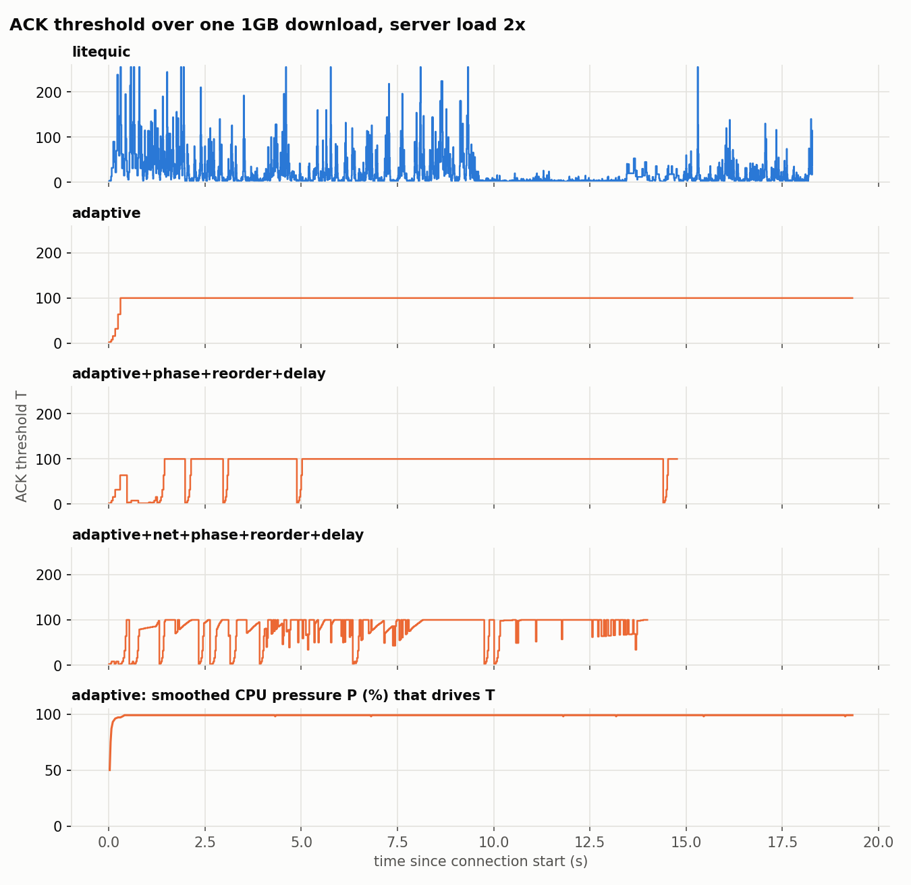
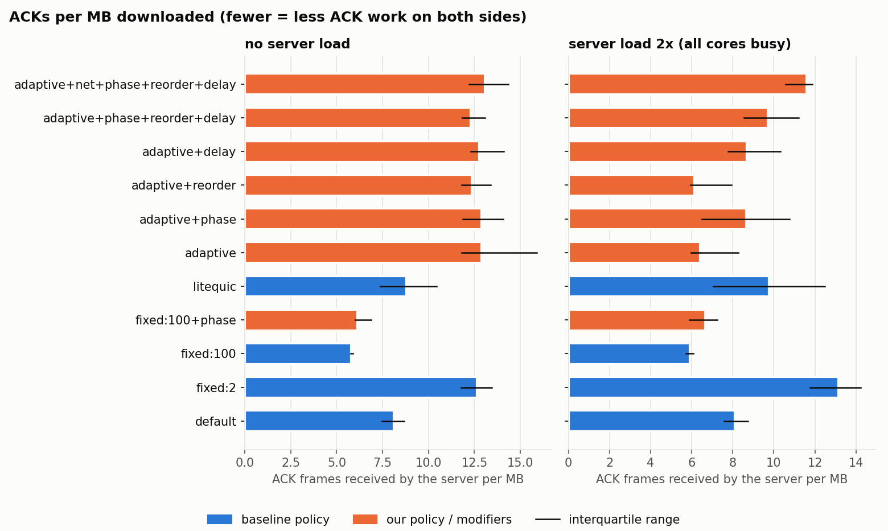
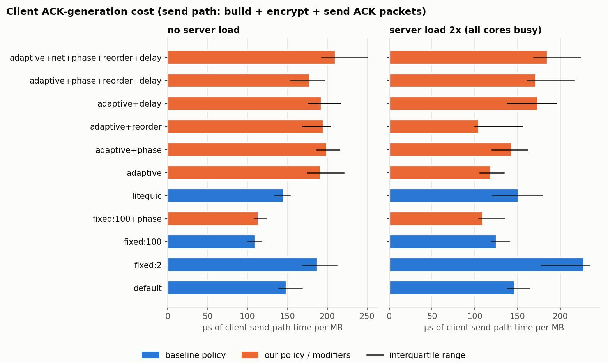
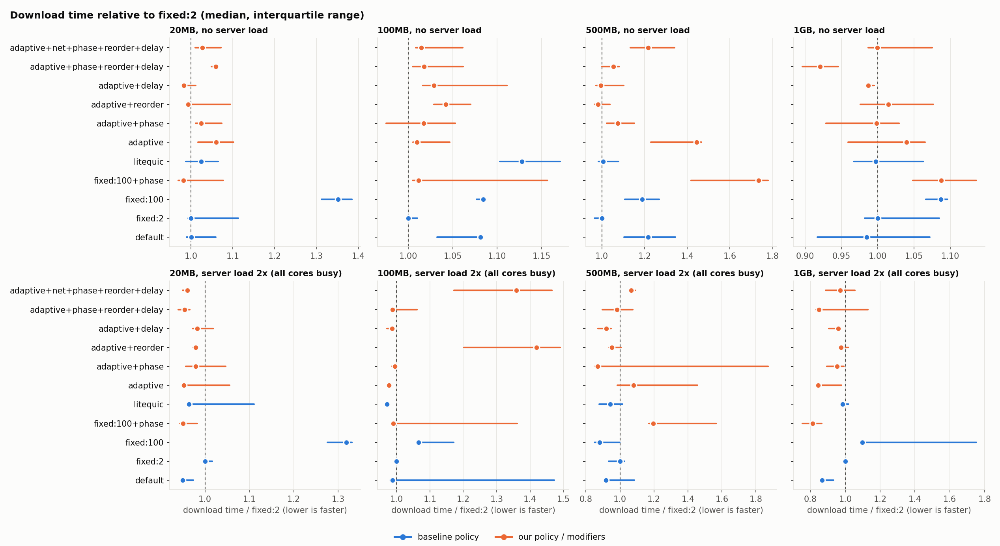

# mcn26: Adaptive ACK Frequency for QUIC

Modern Networks course project (team: Kunal Umaji, Kaveenraj G, Aravindh Sriram Kumar A G).

**Full write-up: [docs/report.md](docs/report.md).**

## The problem in one paragraph

QUIC runs in user space and encrypts everything, including acknowledgements (ACKs).
Every ACK costs CPU twice: the receiver must build, encrypt and send it, and the sender
must receive, decrypt and process it. Studies found that this is a main reason QUIC is
slower and more CPU-hungry than TCP on fast links ([Zhang et al., WWW'24](https://arxiv.org/abs/2310.09423);
[LiteQUIC, MM'24](https://doi.org/10.1145/3664647.3681670)). The IETF
[ACK Frequency extension](https://datatracker.ietf.org/doc/draft-ietf-quic-ack-frequency/)
lets the data sender ask the receiver to ACK less often, but it does not say *how often*.
Fewer ACKs save CPU, but too few starve congestion control and loss detection of feedback.
**This project builds and evaluates policies that choose the ACK frequency dynamically from
CPU and network conditions**, inside Microsoft's QUIC implementation, msquic.

## Key terms

| Term | Meaning |
|---|---|
| **ACK threshold `T`** | The receiver sends an ACK after every `T` ack-eliciting packets. RFC 9000 default: `T = 2` |
| **Max ACK delay** | If fewer than `T` packets arrive, the receiver still ACKs after this delay (25 ms in msquic) |
| **Reordering threshold** | A gap of this many packets makes the receiver ACK immediately (msquic default 1: any gap) |
| **`ACK_FREQUENCY` frame** | Carries the three values above from the data sender to the receiver |
| **Policy** | The rule the server (data sender) uses to choose these values during a connection |

## What we built

| Component | Where | What it does |
|---|---|---|
| ACK policies | `msquic/src/core/connection.c` (search `MCN26`) | `default`, `fixed:N`, `litequic` (reimplementation of LiteQUIC's rule), our `adaptive` |
| Policy modifiers | same | `+phase` (slow-start/recovery aware), `+reorder` (reordering threshold 3), `+delay` (RTT-scaled max ACK delay), `+net` (network ceiling for `adaptive`) |
| ACK-cost instrumentation | `connection.c`, `send.c` | Measures time spent in the receive path, ACK processing and the send path, per connection |
| `quicfile` | `apps/quicfile/` | Client/server on msquic for **file downloads** (with throughput every 100 ms) and **video streaming** (2 s segments, adaptive bitrate, QoE metrics); the policy is a command-line option |
| Evaluation pipeline | `scripts/`, `experiments/`, `analysis/` | Test data, server CPU load, CPU logging, a runner that drives both machines, CSVs, plots |

### The policies

In a download the **server sends data and chooses `T`**; the client (receiver) follows it.

| Policy | How the server chooses `T` |
|---|---|
| `default` | msquic's built-in behaviour (raises `T` to its send batch size + 1 when it cannot send fast enough) |
| `fixed:N` | `T = N` for the whole connection. `fixed:2` is the RFC 9000 behaviour |
| `litequic` | LiteQUIC's rule: once per RTT, `ACK_avg` = ACK frames processed per receive batch. `ACK_avg ≥ 2` (taken as CPU-limited): `T = T × ACK_avg`; otherwise `T = max(T/2, 2)` |
| `adaptive[:N]` | **Ours**: `T` rises with CPU pressure, from 2 (idle) to the ceiling `N` (busy; default 100, at most 255). Details below |

**Modifiers** can be added to `fixed`, `litequic` and `adaptive` (runner syntax `policy+modifier+...`):

| Modifier | Rule | Why |
|---|---|---|
| `+net` | `adaptive` only: the maximum `T` comes from the path: `cwnd_packets / 4`, halved while packets queue (smoothed RTT > 2× min RTT and > min RTT + 5 ms), and `T` halves on loss | Congestion control keeps at least 4 ACKs per window |
| `+phase` | Cubic slow start: `T ≤ max(2, cwnd_packets / 4)`; loss recovery: `T = 2` | A large `T` with a small window makes the receiver wait for its 25 ms timer in every slow-start round |
| `+reorder` | Reordering threshold 3 instead of 1 | The sender can only declare a packet lost after 3 later packets are acknowledged (RFC 9002), so ACKs for smaller gaps are wasted |
| `+delay` | Max ACK delay `= SRTT / 4`, between 1 and 25 ms | The timer fallback should scale with the path, not be a fixed 25 ms |

### How `adaptive` calculates `T`

Every `max(smoothed RTT, 20 ms)` while ACKs arrive, the server:

1. **Measures CPU pressure `P`** (0–100%), the higher of:
   - **QUIC thread pressure**: for the msquic thread processing this connection,
     `(time running + time waiting for a CPU) / elapsed time` (`/proc/thread-self/schedstat`);
   - **whole-machine CPU utilisation** (`/proc/stat`): when the server is busy, every cycle
     spent on ACKs is taken from other work.

   and smooths it: `P = (P_previous + P_new) / 2`.
2. **Scales**: `f(P) = 0` below 50%, `1` above 90%, linear in between: `f = (P − 50) / 40`.
3. **Chooses the ceiling `C`**: 100 (`adaptive:N` or `-ackmax:N`, at most 255 because msquic
   stores the threshold in 8 bits), or with `+net` the network ceiling above.
4. **Target**: `T = 2 + (C − 2) × f(P)`. Examples: `P ≤ 50% → 2`, `60% → 26`, `70% → 51`,
   `80% → 75`, `≥ 90% → 100`.
5. **Safety**: `T` at most doubles per window (decreases apply at once); with `+net`, a loss
   caps `T` at half its current value.

The new values go to the client in an `ACK_FREQUENCY` frame when they change.
Every decision is logged with its inputs (`ack_decisions.csv`). Environment variables
`MCN_ACK_CPU_LO` (50), `MCN_ACK_CPU_HI` (90), `MCN_ACK_MAX` (100) and `MCN_ACK_PER_CWND` (4)
tune it. Design rationale: [docs/design.md](docs/design.md).

### How ACK cost is measured

perf needs root on the server, so msquic itself measures (nanosecond clock) and prints one
`[mcn-stats]` line per connection (with `-acklog:1`):

| Metric | Measured around | Meaning in a download |
|---|---|---|
| `server_recv_us_per_mb` | `QuicConnFlushRecv` on the server | The server receives almost only ACK packets: **time to decrypt and process ACKs** |
| `server_ack_proc_us_per_mb` | `QuicLossDetectionProcessAckFrame` | Only the ACK-frame processing part of the above |
| `client_send_us_per_mb` | `QuicSendFlush` on the client | The client sends almost only ACK packets: **time to build, encrypt and send ACKs** |

Kernel time in the UDP system calls is not included (it runs in msquic's datapath threads).

### How the server CPU load is generated

`scripts/cpu-load.sh Kx` starts `K` busy-loop processes (`while :; do :; done`) per server core,
at normal priority and without root: `2x` on the 28-core server is 56 processes, `4x` is 112.
They stand in for the server's other work, such as other connections and the application.

**Where the busy loops run matters.** Linux groups processes by session ("autogroup", enabled
by default on Ubuntu: `/proc/sys/kernel/sched_autogroup_enabled`) and shares CPU time fairly
between groups first, then between the threads inside a group.
- **Until Nov 12 (`LOAD_SCOPE=separate`)** the busy loops ran in their own session. The machine
  was 100% busy, but the QUIC server still got a CPU almost whenever it wanted one: its worker
  thread's CPU demand (running + waiting) was 24% under "2x" load vs 28% with no load. That
  load only made the server *look* busy, so download speed never changed.
- **Since Nov 14 (`LOAD_SCOPE=shared`, the default)** the runner starts the busy loops and all
  servers in **one** session (`scripts/server-session.sh`). Each busy loop now competes
  one-to-one with the QUIC threads: at `2x` a QUIC thread gets about a third of a core, at `4x`
  about a fifth. This models a server whose own work competes with ACK processing.

## Results

Main run: [`results/20261112-012708`](results/20261112-012708) (Wi-Fi, ~600 Mbit/s, 264 downloads
of 20 MB–1 GB, 11 policy variants, idle server and fully loaded server).
Details and discussion: [docs/report.md](docs/report.md).

1. **`adaptive` does what it is designed to do.** Idle server: `T = 2` (RFC behaviour, full
   feedback). Fully loaded server: `T` ≈ 91, **51% fewer ACKs** and **48% less client
   ACK-generation time** than `fixed:2`, with **no download-time penalty** (0.98× `fixed:2`).
2. **`+phase` removes the cost of a high threshold for small transfers.** `fixed:100` made 20 MB
   downloads ~35% slower (0.37 s vs 0.27 s); `fixed:100+phase` took 0.26–0.27 s while keeping
   almost all of the ACK savings.
3. **At high rates msquic already batches ACKs** (~56 data packets per ACK even at `T = 2`), so the
   server's remaining cost is per acknowledged packet and changed by at most −12%.
4. **LiteQUIC's rule misreads Wi-Fi:** it raised `T` to ~59 on an *idle* server and sent ~70
   `ACK_FREQUENCY` frames per second.
5. **`+reorder` had nothing to act on** (no reordered packet in 261 downloads); `+delay` and `+net`
   make `adaptive` more conservative (more ACKs) with no measurable download-time change here.
6. **CPU frequency matters for measurement:** the server ran at 822 MHz idle vs 2715 MHz loaded,
   which changes per-MB costs by ~45%; compare costs only within a load level.

|  |  |
|---|---|
|  |  |

## Repository layout

| Path | Contents |
|---|---|
| `msquic/` | Vendored [microsoft/msquic](https://github.com/microsoft/msquic) `v2.6.3` (commit `16ca4d8`) with our changes, marked `MCN26` |
| `apps/quicfile/` | Download and video-streaming client/server used in all experiments |
| `scripts/setup.sh` | Builds msquic, `secnetperf` and `quicfile` |
| `scripts/make-testdata.sh` | Creates the test files (20 MB, 100 MB, 500 MB, 1 GB, video segments at 10–400 Mbit/s; random data) and a TLS certificate |
| `scripts/cpu-load.sh` | CPU load: `N` or `Kx` (K per core) busy-loop processes |
| `scripts/server-session.sh` | Runs all servers of a run and the CPU load in one session, so the load competes with the QUIC threads (see [Server CPU load](#how-the-server-cpu-load-is-generated)) |
| `scripts/cpumon.py` | Logs machine and `quicfile` CPU every 200 ms |
| `experiments/run_quicfile.sh` | The evaluation runner (run on the client) |
| `analysis/parse_results.py` | Turns a run into `runs.csv` (downloads) or `videos.csv` (video sessions), `ack_decisions.csv`, `summary.csv` |
| `analysis/plot.py` | Draws the figures of a run into `results/<run>/figures/` |
| `analysis/summarize.py` | Prints the report's tables (markdown) for a run |
| `results/` | One folder per evaluation run; index in [results/README.md](results/README.md) |
| `docs/` | [Report](docs/report.md), [design notes](docs/design.md), [BibTeX](docs/refs.bib) |
| `proposal/` | Course proposal |

## Reproducing the results

You need two Linux machines (we used Ubuntu 24.04): a **server** that serves the files and a
**client** that downloads them. Everything is started on the client, which controls the
server over SSH.

### 1. Requirements

- CMake ≥ 3.16, GCC, Ninja, `libssl-dev`, `libnuma-dev`, `openssl`, Python 3.
  `INSTALL_DEPS=1 scripts/setup.sh` installs them with apt (needs sudo).
- `matplotlib` on the client for the figures (`pip install matplotlib`).
- Disk: about 250 MB for sources and build; 1.6 GB for the test files on the server.
- No root access is needed on either machine.

### 2. Set up both machines (same commit on both)

```bash
git clone https://github.com/kunalumaji/mcn26.git ~/Documents/mcn26
cd ~/Documents/mcn26
scripts/setup.sh            # builds into build/msquic/bin/Release/ (also fetches quictls)
```

On the **server** only, create the test files and certificate (in `data/`, not in git):

```bash
scripts/make-testdata.sh
```

On the **client**: `ssh <user>@<server>` must work without a password (SSH key), and UDP
ports 4433–4445 on the server must be reachable.

If the server cannot reach GitHub, push the commit to it from the client instead:

```bash
git push ssh://<user>@<server>/home/<user>/Documents/mcn26 main:refs/heads/from-client
ssh <user>@<server> 'cd ~/Documents/mcn26 && git merge --ff-only from-client && scripts/setup.sh'
```

### 3. Run the evaluation (on the client)

The exact command for the main results (`results/20261112-012708`):

```bash
SERVER=<user>@<server-ip> FILES="20MB.bin 100MB.bin 500MB.bin 1GB.bin" REPS=3 SERVER_LOADS="0 2x" \
    experiments/run_quicfile.sh
python3 analysis/plot.py results/<timestamp>        # figures into results/<timestamp>/figures/
python3 analysis/summarize.py results/<timestamp>   # the report's tables (markdown)
```

It downloads every file with all 11 policy variants, 3 times, with no server load and with 2
busy-loop processes per server core: 264 downloads, 33 minutes over ~600 Mbit/s Wi-Fi (the runtime
scales with link speed). At the end it prints a summary table and writes `results/<timestamp>/`.
A 1-minute check of the pipeline:

```bash
FILES=20MB.bin REPS=1 POLICIES="fixed:2 fixed:100 adaptive" experiments/run_quicfile.sh
```

| Variable | Default | Meaning |
|---|---|---|
| `SERVER` | `kunal@10.21.232.3` | SSH target of the server |
| `SERVER_IP` | host part of `SERVER` | Address the client downloads from |
| `SERVER_ROOT` | `Documents/mcn26` | Repo path on the server, relative to its home |
| `FILES` | `20MB.bin 100MB.bin 500MB.bin 1GB.bin` | Files to download (from the server's `data/files/`) |
| `POLICIES` | the 11 specs of the final run | `default`, `fixed:N`, `litequic`, `adaptive`, each optionally `+net`, `+phase`, `+reorder`, `+delay` |
| `SERVER_LOADS` | `0 2x` | Server CPU load levels: `0` none, `N` busy loops, `Kx` K per core |
| `CLIENT_LOAD` | `0` | CPU load on the client during all runs |
| `REPS` | `3` | Repetitions per (load, file, policy) |
| `CC` | `cubic` | Congestion control: `cubic` or `bbr` |
| `ALLOW_DIRTY` | unset | `1` skips the check that both machines are on the same clean commit |

What the runner does:
- **Refuses to start** unless client and server are on the same commit with no uncommitted
  changes, so every result comes from identical code (`meta.txt` records both commits).
- Starts **one server per policy**, each on its own port, and **interleaves** downloads across
  policies, rotating the order every repetition, so slow changes in the network affect all
  policies equally.
- Logs CPU on both machines every 200 ms (`scripts/cpumon.py`).
- If a download fails, saves the client's output in `failures.log` and restarts that policy's
  server (`restarts.log`).

### 4. Outputs (`results/<timestamp>/`)

| File | Contents |
|---|---|
| `meta.txt` | Settings, commits, hosts, kernels |
| `runs.csv` | **One row per download**: `download_s` (connection start to last byte), `goodput_mbps`, `data_pkts_per_ack`, `server_recv_ack_frames`, `server_recv_us_per_mb`, `server_ack_proc_us_per_mb`, `client_send_us_per_mb`, process CPU per MB, machine CPU %, losses, reordered packets, RTT, mean threshold `T` |
| `summary.csv` | Medians per (server load, policy, file) |
| `ack_decisions.csv` | Every threshold decision over time with the policy's inputs |
| `cpu_client.csv`, `cpu_server.csv` | CPU time series of both machines |
| `client.log`, `server.log` | Raw output (`RESULT`, `SERVER`, `[mcn]`, `[mcn-stats]` lines) |
| `figures/` | Plots from `analysis/plot.py` |

### 5. A single download by hand

```bash
# server
build/msquic/bin/Release/quicfile server -dir:data/files -cert:data/cert.pem -key:data/key.pem \
    -policy:adaptive -ackphase:1 -ackreorder:3 -ackdelay:1 -acklog:1
# client
build/msquic/bin/Release/quicfile client -target:<server-ip> -file:100MB.bin -acklog:1
```

Options: `-policy:default|fixed|litequic|adaptive`, `-threshold:N` (fixed), `-acknet:1`,
`-ackmax:N`, `-ackphase:1`, `-ackreorder:N`, `-ackdelay:1`, `-cc:cubic|bbr`, `-port:N`,
`-out:<path>` (client: save the file), `-tag:<id>`. The client prints a `RESULT` line, the server
a `SERVER` line per connection; `-acklog:1` adds `[mcn]` decisions and `[mcn-stats]`.

### Troubleshooting

- **Server started over SSH dies when the session ends**: start it with
  `setsid -f ... < /dev/null` (the runner does). `nohup`/`timeout` do not survive.
- **Link speed**: check `cat /sys/class/net/<iface>/speed` (or `ethtool <iface>`) on both machines
  before a run. A gigabit port that comes up at 100 Mbit/s although both ends support 1 Gbit/s
  usually has a damaged cable; results from different link speeds are not comparable.
- **Downloads stall under heavy load** (seen a few times): the runner restarts the server; the
  client's output is in `failures.log`.
