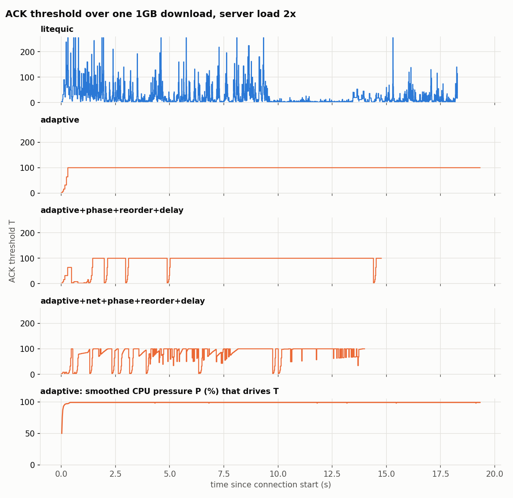
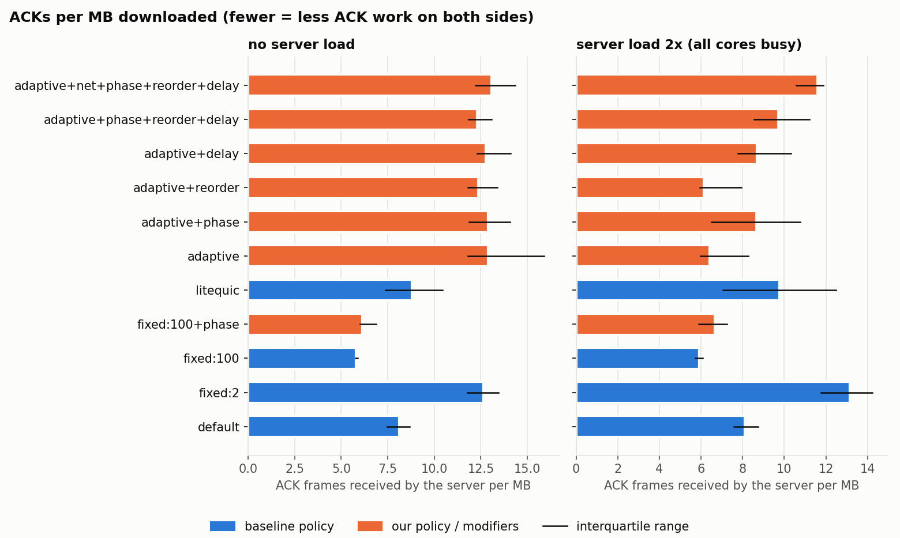
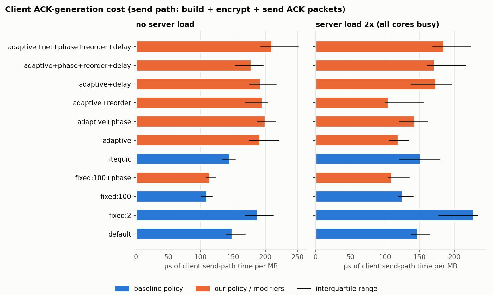
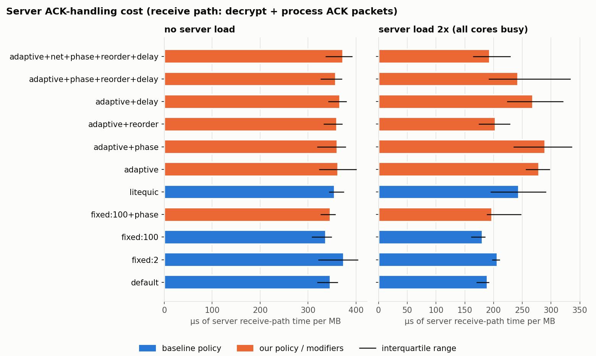
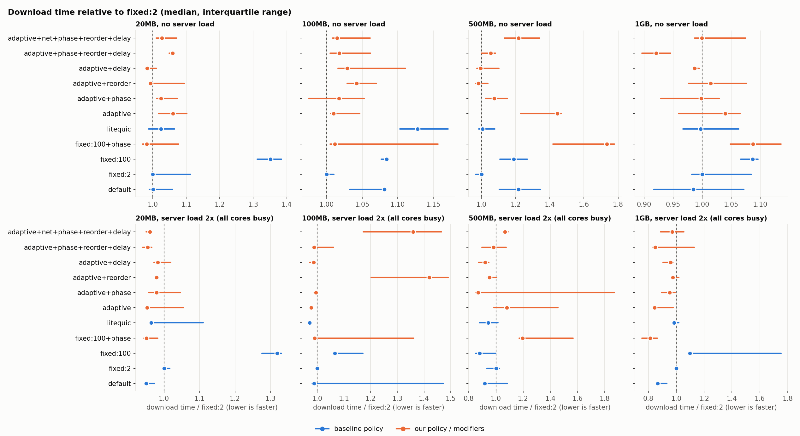

# Adaptive ACK Frequency for QUIC: Reducing ACK Overhead from CPU and Network Signals

Modern Networks course project · Kunal Umaji, Kaveenraj G, Aravindh Sriram Kumar A G

Code, data and reproduction instructions: repository [README](../README.md).

## Abstract

QUIC acknowledges data in user space with encrypted packets, so every ACK costs CPU on
both ends. The IETF ACK Frequency extension lets a data sender ask its peer to acknowledge
less often, but leaves the choice of frequency open. We implemented, inside msquic,
four policies for choosing the ACK threshold `T` (`fixed`, msquic's `default`, a
reimplementation of LiteQUIC's rule, and our CPU-driven `adaptive` policy) plus three
modifiers that use the other fields of the `ACK_FREQUENCY` frame and the congestion state
(`+phase`, `+reorder`, `+delay`). We added nanosecond instrumentation of ACK handling to
msquic and evaluated 11 policy variants on 264 file downloads (20 MB–1 GB) between two
machines over Wi-Fi, with and without a fully loaded server.
At ~600 Mbit/s, msquic's receive batching already yields ~56 data packets per ACK at `T = 2`.
`adaptive` keeps `T = 2` on an idle server, raises it to ~91 under full CPU load, halves the ACK
count and cuts the client's ACK cost by 48% without slowing downloads, while the server-side ACK
cost is dominated by per-acknowledged-packet work that no ACK policy removes. Our `+phase`
modifier removes the small-file slowdown that large thresholds cause, and LiteQUIC's rule
misreads Wi-Fi ACK bursts as CPU overload.

## 1. Introduction

TCP acknowledgements are generated and processed in the kernel, are tiny, and benefit from
offloads such as GRO/LRO and delayed ACKs. QUIC moves the transport into user space and
encrypts every packet, including ACK-only packets. Zhang et al. [1] showed that this
receiver-side processing, in particular user-space ACKs, is a root cause of QUIC reaching
up to 45% lower throughput than TCP+TLS on fast links. LiteQUIC [2] measured ACK
processing as 18% of a QUIC server's CPU and proposed reducing the ACK frequency only
when the server is CPU-limited.

The IETF ACK Frequency extension [3] provides the mechanism: the data sender sends an
`ACK_FREQUENCY` frame with an ack-eliciting threshold `T` (ACK after `T` packets), a
requested max ACK delay and a reordering threshold. It deliberately does not say how to
choose them. Fewer ACKs save CPU on both sides, but delay feedback to congestion control
(window growth in slow start, loss detection, pacing).

**Our question:** can the sender choose the ACK frequency at run time from CPU and network
conditions so that it saves ACK work when CPU is scarce, without hurting download time?

Contributions:
1. Five ACK policies and three modifiers implemented in msquic v2.6.3, selectable at run
   time, all spec-compliant (only the sender's `ACK_FREQUENCY` frames change).
2. `adaptive`: a threshold driven by measured CPU pressure (QUIC thread pressure from
   the scheduler, and machine utilisation), optionally capped by a network ceiling.
3. Modifiers for the remaining `ACK_FREQUENCY` fields and congestion state: slow-start and
   recovery awareness, reordering threshold, RTT-scaled max ACK delay.
4. Direct measurement of ACK cost inside msquic (no root or perf needed), and an automated,
   reproducible two-machine evaluation pipeline.

## 2. Background and related work

**ACK frequency in QUIC.** RFC 9000 recommends an ACK for every second ack-eliciting packet
(`T = 2`) or after `max_ack_delay` (25 ms default). The ACK Frequency draft [3] adds the
`ACK_FREQUENCY` frame (threshold, requested max ACK delay, reordering threshold) and
`IMMEDIATE_ACK`. The receiver may ACK more often than requested, never less.

**Fixed reductions.** Fairhurst et al. proposed changing the default to one ACK per ten
packets [4]; Custura et al. [5] found a ratio of 10 works when the RTT exceeds the ACK delay
and proposed scaling the ACK delay with the RTT (our `+delay`).

**Adaptive schemes.** LiteQUIC [2] infers a CPU-limited server from ACK backlog: once per RTT
it computes `ACK_avg`, the ACK frames returned per `recvmmsg()` call; `ACK_avg ≥ 2` multiplies
`T` by `ACK_avg`, otherwise `T` halves (minimum 2). It also merges queued ACK frames and uses
GSO and PicoTLS. Its code is not public; we reimplemented the adaptive rule. Liu et al. set the
ACK frequency from the bandwidth-delay product in Wi-Fi [6]; TACK [7] (TCP) combines
byte-counting and periodic ACKs to reach a controlled ACK rate. None of these uses a direct
CPU measurement.

## 3. Design

All policies run at the **data sender** (the server in a download) and act only through
`ACK_FREQUENCY` frames, so the receiver is a stock msquic client.

### 3.1 Policies

| Policy | Rule |
|---|---|
| `default` | msquic unchanged: raises `T` to its send batch size + 1 when send-scheduling-limited; 2 after persistent congestion |
| `fixed:N` | `T = N` |
| `litequic` | LiteQUIC's rule (above). msquic's per-connection code does not see `recvmmsg()` calls; we count ACK frames per receive-queue drain (`QuicConnFlushRecv`), the closest equivalent |
| `adaptive` | ours, below |

### 3.2 `adaptive`

Every `max(SRTT, 20 ms)`:

1. **CPU pressure** `P = max(P_thread, U_sys)`, smoothed by `P ← (P + P_new) / 2`.
   `P_thread` is the share of time the msquic worker thread handling the connection *wanted*
   a CPU: `(Δ run time + Δ run-queue wait) / Δ wall time`, from
   `/proc/thread-self/schedstat` (the idea follows Linux's CPU pressure metrics: waiting time
   shows starvation that run time alone hides). `U_sys` is whole-machine utilisation from
   `/proc/stat`: when the server is busy, every cycle spent on ACKs is taken from other work.
2. **Scale** `f(P)`: 0 below 50%, 1 above 90%, linear in between.
3. **Ceiling** `C = 100` (LiteQUIC's largest tested threshold). With `+net`:
   `C = cwnd_packets / 4` (at least 4 ACKs per window), halved while packets queue
   (SRTT > 2 × min RTT and > min RTT + 5 ms), within `[2, 100]`; a loss halves `T`.
4. **Threshold** `T = 2 + (C − 2) · f(P)`, at most doubling per window.

So an idle server keeps RFC behaviour (`T = 2`, best feedback) and a busy server reduces ACKs
as far as the ceiling allows. The 50/90% bounds and the linear shape are simple defaults,
not tuned values.

### 3.3 Modifiers

Applied to every threshold that `fixed`, `litequic` or `adaptive` chooses:

| Modifier | Rule | Rationale |
|---|---|---|
| `+phase` | Cubic slow start: `T ≤ max(2, cwnd_packets / 4)`; loss recovery: `T = 2` | With `T` larger than the packets in flight, the receiver waits for its 25 ms timer every slow-start round (earlier runs: `fixed:100` slowed 20 MB downloads by 33%) |
| `+reorder` | Reordering threshold 3 instead of msquic's 1 | The sender declares a loss only after 3 later packets are acknowledged (RFC 9002), so an immediate ACK for a smaller gap carries no actionable information [3, §9] |
| `+delay` | Max ACK delay `= SRTT / 4`, within [1, 25] ms | Scale the timer fallback with the path [5] |

Other ideas from our brainstorm (client-side CPU via a hint frame, event-driven
`IMMEDIATE_ACK`, flow-size awareness, BBR-specific ceilings, server-wide ACK budgets,
LiteQUIC's ACK merge) are listed in [design.md](design.md) as future work.

## 4. Implementation

- **msquic** (vendored v2.6.3, all changes marked `MCN26`, mainly `src/core/connection.c`):
  policy selection by environment variables read once per process; the policies; a single
  function that applies the modifiers and sends all three `ACK_FREQUENCY` fields when any
  changes; msquic's own threshold heuristics run only under `default`.
- **Instrumentation**: per connection, nanosecond time in `QuicConnFlushRecv` (receive path),
  `QuicLossDetectionProcessAckFrame` (ACK frames) and `QuicSendFlush` (send path), printed as
  `[mcn-stats]` at shutdown. In a download the server receives almost only ACK packets and the
  client sends almost only ACK packets, so the server receive path is the ACK-processing cost
  and the client send path the ACK-generation cost. Kernel time in UDP system calls is excluded.
- **quicfile**: a download client/server on msquic (one request stream, file streamed with
  64 × 256 KiB buffers, large flow-control windows); reports download time, packets, ACKs,
  losses, RTT, process and machine CPU.
- **Pipeline**: test-data generation, busy-loop CPU load, CPU time-series logging, a runner
  that checks both machines run the same commit, starts one server per policy, interleaves
  and rotates downloads, restarts a server after a failure; CSV parser and plots.

## 5. Methodology

**Testbed.** Server: Intel Core i7-14700 (28 cores), 31 GB, Ubuntu 24.04, kernel 7.0, wired
1 Gbit/s to the campus LAN. Client: Intel Core i5-1335U (12 cores), 15 GB, same OS, on campus
Wi-Fi with ~600 Mbit/s to the server. CPU frequency governor `powersave` on both (no root to
change it). Congestion control Cubic, pacing on.

**Workload.** Downloads of 20 MB, 100 MB, 500 MB and 1 GB files of random data (one connection at
a time), 11 policy variants, 3 repetitions, two server CPU loads: none, and **2x** = 56 busy-loop
processes (2 per core) at normal priority, so the machine is 100% busy. 264 downloads. All policies are interleaved within each repetition and their order
rotates between repetitions.

**Metrics** (per download): download time (connection start to last byte); ACK frames received
by the server per MB; data packets per ACK; server receive-path µs per MB (ACK-processing cost);
client send-path µs per MB (ACK-generation cost); losses; reordered packets; time-weighted mean
`T`. We report medians and interquartile ranges (IQR) over repetitions.

**Earlier runs.** Two earlier evaluations over Wi-Fi (Oct 28–29, results in `results/`)
motivated the modifiers and the instrumentation; they are summarised in §7.

**Reproduction.** Main run: `FILES="20MB.bin 100MB.bin 500MB.bin 1GB.bin" REPS=3
SERVER_LOADS="0 2x" experiments/run_quicfile.sh` (default policy list), then
`analysis/plot.py` and `analysis/summarize.py` on the result folder. Both machines ran commit
`8f618e1` (recorded in `meta.txt`).

## 6. Results

Data set: **run `20261112-012708`** (client on Wi-Fi, ~600 Mbit/s, 264 downloads, 261
successful). Tables are produced by `analysis/summarize.py`, figures by `analysis/plot.py`.

### 6.1 Policies behave as designed

*Figure 1: threshold `T` during one 1 GB download with the server fully loaded (Wi-Fi).*

- **`adaptive`** keeps `T = 2` on an idle server (CPU pressure 6–52%, mean `T` exactly 2 in all
  12 idle downloads) and, under load, ramps to the maximum within ~0.3 s (`P` ≈ 99% from machine
  utilisation) and stays there (median of per-download mean `T` ≈ 91; lower for 20 MB files, which
  spend more of their time ramping up). It sends 0–3 `ACK_FREQUENCY` frames per second.
- **`litequic`** oscillates between 2 and 255 and sends ~70 `ACK_FREQUENCY` frames per second.
  On Wi-Fi it raises `T` even on an **idle** server (mean `T` ≈ 59): the access point delivers
  ACKs in bursts, which its ACK-backlog signal reads as CPU overload.
- **`+phase`** drops `T` to 2 during each loss recovery and caps it during slow start;
  **`+net`** additionally follows the congestion window and queueing delay (Figure 1).

### 6.2 ACK counts

*Figure 2: ACK frames received by the server per MB (Wi-Fi; bars = median, lines = IQR).*

On Wi-Fi, `fixed:2` already produces only ~13 ACKs per MB (~56 data packets per ACK): msquic sends
one ACK per receive batch, not per `T` packets (§7). Raising `T` can therefore at most halve the
ACK count here: `fixed:100` 5.8/MB, `adaptive` under load 6.4/MB (−51% vs `fixed:2`).

### 6.3 ACK cost

Pooled over the 4 file sizes (n = 11–12 per row; IQR in brackets):

| Load | Policy | ACKs/MB | Mean `T` | Server ACK µs/MB | vs `fixed:2` | Client ACK µs/MB | vs `fixed:2` | Download time vs `fixed:2` |
|---|---|---|---|---|---|---|---|---|
| none | `fixed:2` | 12.6 | 2 | 375 | 1.00 | 188 | 1.00 | 1.000 [0.996–1.018] |
| none | `default` | 8.1 | – | 347 | 0.93 | 149 | 0.79 | 1.041 [0.985–1.128] |
| none | `fixed:100` | 5.8 | 100 | 337 | 0.90 | 110 | 0.59 | 1.096 [1.081–1.291] |
| none | `litequic` | 8.8 | 59 | 356 | 0.95 | 145 | 0.77 | 1.051 [0.988–1.128] |
| none | `adaptive` | 12.9 | 2 | 363 | 0.97 | 192 | 1.02 | 1.050 [1.007–1.104] |
| 2x | `fixed:2` | 13.1 | 2 | 207 | 1.00 | 228 | 1.00 | 1.000 [0.990–1.015] |
| 2x | `default` | 8.1 | – | 189 | 0.92 | 147 | 0.64 | 0.961 [0.916–0.997] |
| 2x | `fixed:100` | 5.9 | 100 | 181 | 0.88 | 126 | 0.55 | 1.107 [1.065–1.288] |
| 2x | `litequic` | 9.8 | 61 | 244 | 1.18 | 152 | 0.67 | 0.972 [0.964–1.002] |
| 2x | `adaptive` | 6.4 | 91 | 279 | 1.35 | 119 | **0.52** | 0.976 [0.933–1.088] |

All 11 variants are in [`summary.csv`](../results/20261112-012708/summary.csv) and the table
printed by `analysis/summarize.py`.

*Figure 3: client send-path time per MB (ACK generation), Wi-Fi.*

*Figure 4: server receive-path time per MB (ACK processing), Wi-Fi.*

- **Client:** fewer ACKs → proportionally less ACK-generation time. Under load `adaptive`
  halves it (−48%), `fixed:100` −45%; with an idle server `adaptive` correctly spends the same as
  `fixed:2`.
- **Server:** with ~56 packets per ACK already, the remaining server cost is mostly per
  *acknowledged packet* (each ACK frame took 12–25 µs at `T = 2` and 28–52 µs at `T = 100`,
  ). Halving the ACK
  count changed it by at most −12% (`fixed:100`). `adaptive` under load measured +35% (IQR
  256–297 vs 198–210 µs/MB) despite half the ACKs; its CPU readings run outside the timed code and
  cost 14 µs per decision (~10 µs/MB), so this remains unexplained (cache effects of reading
  `/proc/stat` are one candidate).
- **CPU frequency** confounds comparisons across load levels: the server's cores averaged
  **822 MHz idle and 2715 MHz under load** (`powersave` governor), so every policy's server-side
  per-MB cost is ~45% lower under load (e.g. `fixed:2`: 375 → 207 µs/MB). Costs are only compared
  within a load level.

### 6.4 Download time

*Figure 5: download time relative to `fixed:2` per file size and load (Wi-Fi).*

- **Large `T` slows small transfers; `+phase` fixes it.** 20 MB with `fixed:100` took
  0.37 s vs 0.27–0.28 s with `fixed:2` (+35%, both loads). With `+phase`, 0.26–0.27 s, while
  keeping almost all of the ACK savings (6.1 vs 5.8 ACKs/MB idle).
- `fixed:100` is the only policy consistently slower overall (median +10% on Wi-Fi).
- **`adaptive` costs no download time**: 0.976× `fixed:2` under load, IQR 0.933–1.088.
- Otherwise Wi-Fi variability (IQRs of ±5–40% on 100 MB–1 GB) is larger than any difference
  between policies; we do not claim speed-ups. For scale: `adaptive` on the idle server behaves
  exactly like `fixed:2` (`T = 2` throughout), yet measured 1.050× [1.007–1.104].

### 6.5 Modifiers (ablation)

| Modifier | Effect observed | Interpretation |
|---|---|---|
| `+phase` | Removes the small-file penalty of large `T` (§6.4); under load ACKs 8.7/MB vs 6.4 for `adaptive` (`T` drops to 2 in recovery) | Works as intended; costs some ACK savings during loss recovery |
| `+reorder` | **No reordered packet in 261 downloads**, so no effect is possible; differences are noise | Wi-Fi delivers frames in order to the host; the modifier matters only on paths with real reordering (multipath, load balancing) |
| `+delay` | Under load ACKs 8.7/MB vs 6.4 (`adaptive`): an SRTT/4 timer (1–10 ms) fires before 100 packets accumulate | Trades ACK savings for timelier feedback; no download-time gain measured |
| `+net` | More conservative: under load mean `T` 53 vs 91, 11.6 ACKs/MB; backs off on loss and queueing (Figure 1) | No benefit measurable here: no shallow-buffer or lossy path was emulated (no root for netem) |

### 6.6 Overhead and reliability

- `adaptive`'s inputs cost 13.1 µs (`/proc/stat`) + 1.3 µs (`schedstat`) per decision, at most
  one decision per 20 ms: < 0.1% of one core.
- 3 of 264 downloads (1.1%) stalled and ended with an idle timeout (`0x6e`), in three different
  policies including `fixed:2`, with and without load; earlier runs show a similar rate. The cause
  is not policy-related and remains open; the runner restarts the server and records the client's
  output in `failures.log`.

## 7. Discussion

**When does ACK frequency matter?** It matters when the receiver actually ACKs often.
msquic's receiver sends one ACK per *receive batch* (reaching `T` only marks an ACK as due), so at
high packet rates it already ACKs every ~50–60 packets, and the ACK frequency extension can only
remove the rest. When packets arrive spaced out (slower links) or in stacks without such batching
(Zhang et al. [1] measured Chromium; LiteQUIC [2] measured nginx-quic), ACKs are frequent and a
higher threshold should remove a larger share of their cost; we did not measure such a setting.

**What should drive the threshold?** Feedback is free when the CPU is idle and costly when it is
busy, so a CPU-driven policy that keeps RFC behaviour on an idle server and reduces ACKs only under
load is sensible: `adaptive` did exactly that, with no download-time penalty. Measuring CPU directly
was more reliable than LiteQUIC's indirect ACK-backlog signal, which confused Wi-Fi burstiness with
CPU overload and churned ~70 `ACK_FREQUENCY` frames per second.

**Which savings are real?** The client's ACK-generation cost falls with the ACK count. On the
server, ACK processing is dominated by per-packet bookkeeping once ACKs are batched; reducing that
needs different techniques (LiteQUIC's ACK merge, cheaper sent-packet tracking).

**Measurement lessons.** Whole-process CPU (our first two runs) could not show ACK savings at all;
instrumenting the ACK paths could. The CPU frequency governor changed per-MB costs by ~2× between
load levels, more than any policy did.

**Earlier runs (Oct 28–29, Wi-Fi, process-CPU metrics only).** They showed the same policy
behaviour (`adaptive` 2 → ~90, 56% fewer ACKs under load; `litequic` `T` ≈ 44 on an idle server)
and the 20 MB slowdown of `fixed:100` (+33%) that motivated `+phase`.

## 8. Limitations and future work

- **Testbed:** one client and one server; Wi-Fi throughput varies between runs, so differences
  under ~10% in download time are not resolvable with n = 3 per cell.
- **Workload:** single connections only. Multi-connection servers (LiteQUIC's setting) would make
  ACK processing a larger share of CPU.
- **No network emulation** (needs root): `+net` and `+delay` were not tested on lossy,
  shallow-buffer or long-RTT paths, and `+reorder` saw no reordering.
- **Measurement:** kernel UDP time is not included; CPU frequency was not fixed; the `adaptive`
  server-cost anomaly (§6.3) is unexplained; rare stalls (~1%) are unexplained.
- **Design choices** (50/90% bounds, linear scale, ceiling 100, cwnd/4) are defaults, not tuned.
  At full load the policy behaves as a switch (2 or 100); partial loads would exercise the ramp.
- Linux only (`/proc`), Cubic only for `+phase`.

**Future work:** client-side CPU awareness through a CPU-hint frame (the receiver may only ACK
*more* often than asked); event-driven `IMMEDIATE_ACK` at loss and transfer tails; LiteQUIC's ACK
merge for the server-side per-packet cost; BBR; multi-connection and core-limited servers;
emulated lossy/shallow-buffer paths for `+net`; a geometric instead of linear `T` ramp.

## 9. Conclusion

We implemented run-time ACK-frequency policies in msquic, including a CPU-driven `adaptive`
policy and three modifiers, and measured ACK cost directly. A CPU-driven threshold gives the
expected trade-off: RFC behaviour when the server is idle, half the ACKs and half the client's
ACK cost under load, and no download-time penalty. Slow-start awareness (`+phase`) avoids the
small-transfer slowdown that otherwise comes with a high threshold. At high rates with batched ACKs, the server's remaining cost
is per acknowledged packet, which ACK frequency cannot reduce.

## References

1. X. Zhang et al. "QUIC is not Quick Enough over Fast Internet." ACM Web Conference (WWW), 2024.
2. P. Bi et al. "LiteQUIC: Improving QoE of Video Streams by Reducing CPU Overhead of QUIC." ACM Multimedia (MM), 2024.
3. J. Iyengar, I. Swett, M. Kühlewind. "QUIC Acknowledgment Frequency." draft-ietf-quic-ack-frequency-14, IETF, 2026.
4. G. Fairhurst et al. "Changing the Default QUIC ACK Policy." draft-fairhurst-quic-ack-scaling, IETF.
5. A. Custura, T. Jones, R. Secchi, G. Fairhurst. "Reducing the acknowledgement frequency in IETF QUIC." Int. J. Satellite Communications and Networking 41(4), 2023.
6. Y. Liu et al. "Bandwidth-Delay-Product-Based ACK Optimization Strategy for QUIC in Wi-Fi Networks." IEEE Internet of Things Journal 10(20), 2023.
7. T. Li et al. "TACK: Improving Wireless Transport Performance by Taming Acknowledgments." ACM SIGCOMM, 2020.
8. J. Iyengar, M. Thomson. "QUIC: A UDP-Based Multiplexed and Secure Transport." RFC 9000, 2021; J. Iyengar, I. Swett. "QUIC Loss Detection and Congestion Control." RFC 9002, 2021.
