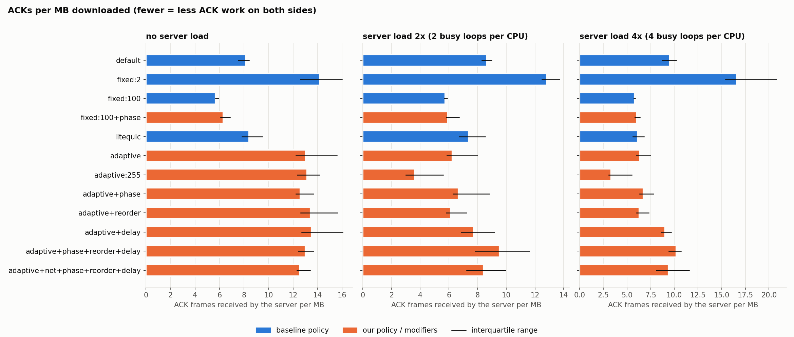
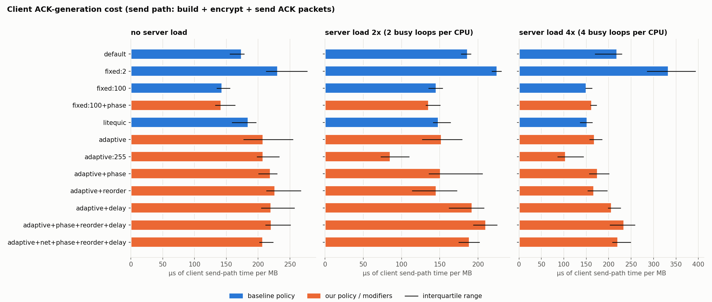
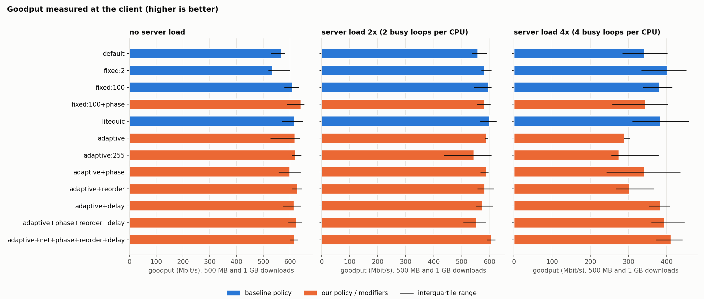
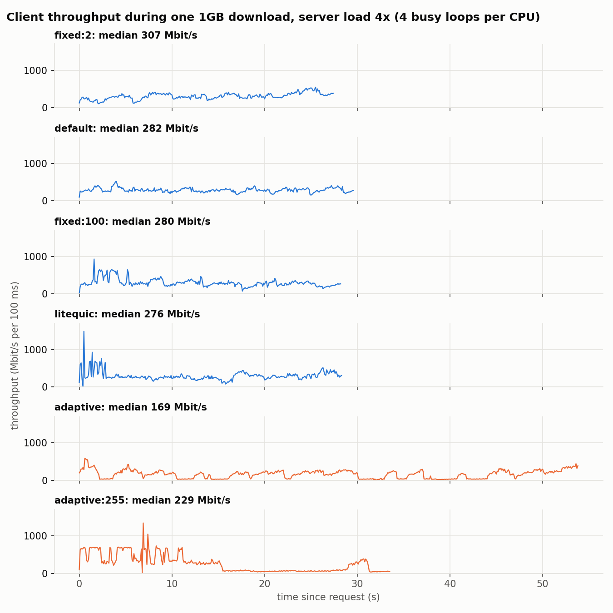
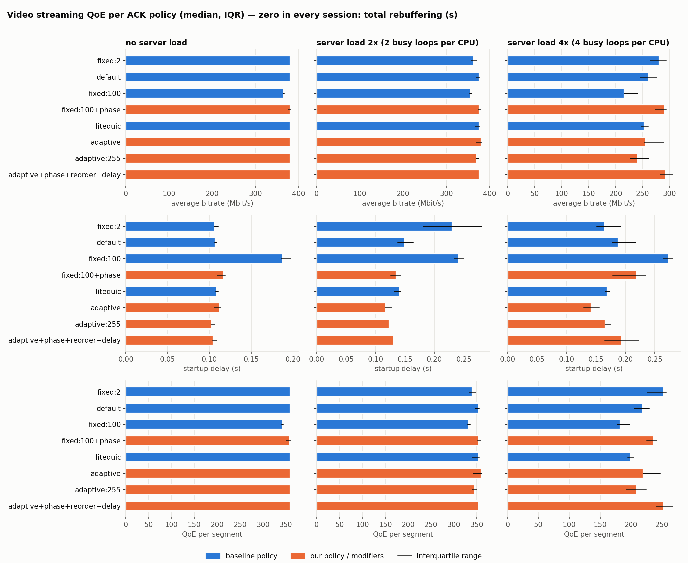

# Adaptive ACK Frequency for QUIC: Reducing ACK Overhead from CPU and Network Signals

Modern Networks course project · Kunal Umaji, Kaveenraj G, Aravindh Sriram Kumar A G

Code, data and reproduction instructions: repository [README](../README.md).

## Abstract

QUIC acknowledges data in user space with encrypted packets, so every ACK costs CPU on both ends.
The IETF ACK Frequency extension lets a data sender ask its peer to acknowledge less often, but
leaves the choice of frequency open. We implemented in msquic four policies for choosing the ACK
threshold `T` (`fixed`, msquic's `default`, a reimplementation of LiteQUIC's rule, and our
CPU-driven `adaptive` with a configurable ceiling) and three modifiers (`+phase`, `+reorder`,
`+delay`), measured ACK cost inside msquic, and evaluated them over ~600 Mbit/s Wi-Fi with 432 file
downloads, a 56-download load sweep and 72 video-streaming sessions, on a server whose QUIC threads
compete with 0–4 busy loops per CPU. `adaptive` keeps `T = 2` on an idle server and raises `T` with
the machine's utilisation; under load it sends 52–67% fewer ACKs than `fixed:2`, cutting the
client's ACK-generation time by 32–57% and the server's ACK-processing time by 10–33%, with
unchanged goodput and video QoE at 2x load. On a CPU-starved server (4x), thresholds of 100 and
more with msquic's 25 ms ACK timer caused occasional throughput collapses, worst with a ceiling of
255; variants with an RTT-scaled ACK delay or a window-based ceiling kept `fixed:2`'s throughput and
QoE with ~40% fewer ACKs. A ceiling is therefore necessary: about 100, or better a quarter of the
congestion window together with a max ACK delay of SRTT/4. Rare connection stalls occurred under
load with all policies; their cause is open. We also show that CPU load from a separate login
session does not load a QUIC server on Linux, a pitfall for CPU-overhead experiments.

## 1. Introduction

TCP acknowledgements are generated and processed in the kernel, are tiny, and benefit from
offloads such as GRO/LRO and delayed ACKs. QUIC moves the transport into user space and
encrypts every packet, including ACK-only packets. Zhang et al. [1] showed that this
receiver-side processing, in particular user-space ACKs, is a root cause of QUIC reaching
up to 45% lower throughput than TCP+TLS on fast links. LiteQUIC [2] measured ACK
processing as 18% of a QUIC server's CPU and proposed reducing the ACK frequency only
when the server is CPU-limited.

The IETF ACK Frequency extension [3] provides the mechanism: the data sender sends an
`ACK_FREQUENCY` frame with an ack-eliciting threshold `T` (ACK after `T` packets), a
requested max ACK delay and a reordering threshold. It deliberately does not say how to
choose them. Fewer ACKs save CPU on both sides, but delay feedback to congestion control
(window growth in slow start, loss detection, pacing).

**Our question:** can the sender choose the ACK frequency at run time from CPU and network
conditions so that it saves ACK work when CPU is scarce, without hurting throughput, download
time or video quality?

Contributions:
1. Five ACK policies and three modifiers implemented in msquic v2.6.3, selectable at run
   time, all spec-compliant (only the sender's `ACK_FREQUENCY` frames change).
2. `adaptive`: a threshold driven by measured CPU pressure (QUIC thread pressure from
   the scheduler, and machine utilisation), up to a configurable ceiling, optionally
   bounded by the congestion window.
3. Modifiers for the remaining `ACK_FREQUENCY` fields and congestion state: slow-start and
   recovery awareness, reordering threshold, RTT-scaled max ACK delay.
4. Measurement inside msquic of the ACK cost on both sides (no root or perf needed), client
   throughput in 100 ms intervals, and a video-streaming client with standard QoE metrics.
5. A reproducible two-machine evaluation, including a methodological finding: CPU load from
   busy loops in a separate login session does not load a QUIC server on Linux, because the
   scheduler shares CPU between sessions first (§5).

## 2. Background and related work

**ACK frequency in QUIC.** RFC 9000 recommends an ACK for every second ack-eliciting packet
(`T = 2`) or after `max_ack_delay` (25 ms default). The ACK Frequency draft [3] adds the
`ACK_FREQUENCY` frame (threshold, requested max ACK delay, reordering threshold) and
`IMMEDIATE_ACK`. The receiver may ACK more often than requested, never less.

**Fixed reductions.** Fairhurst et al. proposed changing the default to one ACK per ten
packets [4]; Custura et al. [5] found a ratio of 10 works when the RTT exceeds the ACK delay
and proposed scaling the ACK delay with the RTT (our `+delay`).

**Adaptive schemes.** LiteQUIC [2] infers a CPU-limited server from ACK backlog: once per RTT
it computes `ACK_avg`, the ACK frames returned per `recvmmsg()` call; `ACK_avg ≥ 2` multiplies
`T` by `ACK_avg`, otherwise `T` halves (minimum 2). It also merges queued ACK frames and uses
GSO and PicoTLS, and evaluates video QoE. Its code is not public; we reimplemented the adaptive
rule. Liu et al. set the ACK frequency from the bandwidth-delay product in Wi-Fi [6]; TACK [7]
(TCP) combines byte-counting and periodic ACKs to reach a controlled ACK rate. None of these
uses a direct CPU measurement.

## 3. Design

All policies run at the **data sender** (the server in a download or video stream) and act only
through `ACK_FREQUENCY` frames, so the receiver is a stock msquic client.

### 3.1 Policies

| Policy | Rule |
|---|---|
| `default` | msquic unchanged: raises `T` to its send batch size + 1 when send-scheduling-limited; 2 after persistent congestion |
| `fixed:N` | `T = N` |
| `litequic` | LiteQUIC's rule (above). msquic's per-connection code does not see `recvmmsg()` calls; we count ACK frames per receive-queue drain (`QuicConnFlushRecv`), the closest equivalent |
| `adaptive[:C]` | ours, below; `C` is the ceiling (default 100) |

### 3.2 `adaptive`

Every `max(SRTT, 20 ms)`:

1. **CPU pressure** `P = max(P_thread, U_sys)`, smoothed by `P ← (P + P_new) / 2`.
   `P_thread` is the share of time the msquic worker thread handling the connection *wanted*
   a CPU: `(Δ run time + Δ run-queue wait) / Δ wall time`, from
   `/proc/thread-self/schedstat` (the idea follows Linux's CPU pressure metrics: waiting time
   shows starvation that run time alone hides). `U_sys` is whole-machine utilisation from
   `/proc/stat`: when the server is busy, every cycle spent on ACKs is taken from other work.
2. **Scale** `f(P)`: 0 below 50%, 1 above 90%, linear in between.
3. **Ceiling** `C`: 100 by default (`adaptive:C` sets it, at most 255). With `+net`:
   `C = cwnd_packets / 4` (at least 4 ACKs per window), halved while packets queue
   (SRTT > 2 × min RTT and > min RTT + 5 ms), within `[2, 100]`; a loss halves `T`.
4. **Threshold** `T = 2 + (C − 2) · f(P)`, at most doubling per window.

So an idle server keeps RFC behaviour (`T = 2`, best feedback) and a busy server reduces ACKs
as far as the ceiling allows. The 50/90% bounds and the linear shape are simple defaults,
not tuned values.

### 3.3 How high may `T` go?

Under full load `adaptive` sits at its ceiling, so the ceiling decides how far ACKs are reduced.
A limit is needed for four reasons:

- **Implementation:** msquic stores the threshold in 8 bits on both sides, so 255 is the maximum.
- **Window:** once `T` exceeds the packets in flight, the receiver can only ACK when its
  max-ACK-delay timer (25 ms) fires, and a window-limited sender waits up to 25 ms per round
  trip. This is what slows small downloads with `fixed:100` (§6.3).
- **Feedback:** RFC 9002 declares a loss once later packets are acknowledged, and Cubic grows
  its window and paces from ACK arrivals. Sparse ACKs delay loss recovery and make sending
  burstier.
- **Guidance:** the ACK Frequency draft leaves the value to the sender but warns about these
  effects [3]; Custura et al. [5] keep several ACKs per RTT. Our `+net` ceiling of
  `cwnd_packets / 4` keeps at least 4 ACKs per window.

Our default ceiling of 100 is LiteQUIC's largest tested value. On our path the congestion window
under load was a median of 470–1000 packets, but its 10th percentile only 150–270 (§6.4): `T = 100`
then leaves about 2–10 ACKs per window, 255 only about 1–4. We therefore compare `adaptive` (ceiling 100) with `adaptive:255` and with
`+net`, whose ceiling follows the window.

### 3.4 Modifiers

Applied to every threshold that `fixed`, `litequic` or `adaptive` chooses:

| Modifier | Rule | Rationale |
|---|---|---|
| `+phase` | Cubic slow start: `T ≤ max(2, cwnd_packets / 4)`; loss recovery: `T = 2` | With `T` larger than the packets in flight, the receiver waits for its 25 ms timer every slow-start round (earlier runs: `fixed:100` slowed 20 MB downloads by 33%) |
| `+reorder` | Reordering threshold 3 instead of msquic's 1 | The sender declares a loss only after 3 later packets are acknowledged (RFC 9002), so an immediate ACK for a smaller gap carries no actionable information [3, §9] |
| `+delay` | Max ACK delay `= SRTT / 4`, within [1, 25] ms | Scale the timer fallback with the path [5] |

Other ideas from our brainstorm (client-side CPU via a hint frame, event-driven
`IMMEDIATE_ACK`, flow-size awareness, BBR-specific ceilings, server-wide ACK budgets,
LiteQUIC's ACK merge) are listed in [design.md](design.md) as future work.

## 4. Implementation

- **msquic** (vendored v2.6.3, all changes marked `MCN26`, mainly `src/core/connection.c`):
  policy selection by environment variables read once per process; the policies; a single
  function that applies the modifiers and sends all three `ACK_FREQUENCY` fields when any
  changes; msquic's own threshold heuristics run only under `default`.
- **Instrumentation**: per connection, nanosecond time in `QuicConnFlushRecv` (receive path),
  `QuicLossDetectionProcessAckFrame` (ACK frames) and `QuicSendFlush` (send path), printed as
  `[mcn-stats]` at shutdown. When the server sends data, it receives almost only ACK packets and
  the client sends almost only ACK packets, so the server receive path is the ACK-processing cost
  and the client send path the ACK-generation cost. Kernel time in UDP system calls is excluded.
- **quicfile** (client/server on msquic, one stream per request, 64 × 256 KiB send buffers,
  large flow-control windows):
  - *downloads*: download time, goodput and throughput in every 100 ms of the transfer;
  - *video streaming*: a VoD session on one connection, one stream per 2 s segment, with a
    throughput-based bitrate choice (highest bitrate ≤ 0.9 × harmonic mean throughput of the
    last 3 segments), a real-time playback buffer (playback starts after the first segment; no
    request while the buffer holds more than 8 s), and the QoE metrics below;
  - both report packets, ACKs, losses, RTT, process and machine CPU.
- **Pipeline**: test-data generation, CPU load, CPU time-series logging, a runner that checks
  both machines run the same commit, runs all servers and the CPU load in one remote session,
  interleaves and rotates policies, restarts a server after a failure; CSV parser, tables and
  plots; `experiments/run_all.sh` runs everything in this report.

## 5. Methodology

**Testbed.** Server: AMD Ryzen 7 5800X (8 cores, 16 hardware threads), 31 GB, Ubuntu 22.04,
kernel 6.8, 1 Gbit/s Ethernet to the campus LAN, CPU governor `schedutil`. Client: Intel Core
i5-1335U (12 threads), 15 GB, Ubuntu 24.04, kernel 7.0, on campus Wi-Fi: 460–660 Mbit/s (median 615) and a
minimum RTT of 1.5–2.1 ms to the server. Congestion control Cubic, pacing on. No root access on
either machine (no network emulation, no fixed CPU frequency).

**Server CPU load.** `K`x load = `K` busy-loop processes per logical CPU at normal
priority (2x = 32, 4x = 64), standing in for the server's other work. Where they run matters.
Linux groups processes by login session ("autogroup", enabled by default on Ubuntu [9]) and
shares CPU time fairly between groups first, then between the threads in a group. In our
earlier runs (Nov 12, on another server) the busy loops ran in their own session: the machine was
100% busy, yet the QUIC worker thread's CPU demand (running + waiting) stayed at 24% vs 28%
unloaded, and no policy's throughput changed. In all runs reported here the busy loops and the QUIC servers run in **one
session**, so each busy loop competes with the QUIC threads one-to-one: at 4x, a QUIC thread
gets about a fifth of a logical CPU.

**Experiments** (all policies interleaved within each repetition, order rotated between
repetitions):

| # | Workload | Policies | Server load | Repetitions |
|---|---|---|---|---|
| 1 | Downloads of 20 MB, 100 MB, 500 MB, 1 GB (random data, one connection at a time) | 12 variants (§6.2) | none, 2x, 4x | 3 → 432 downloads |
| 2 | Load sweep: 500 MB downloads | `fixed:2`, `adaptive`, `adaptive:255`, `adaptive+net+phase+reorder+delay` | none, 0.25x, 0.5x, 0.75x, 1x, 2x, 4x | 2 → 56 downloads |
| 3 | Video streaming: 40 s of video in 2 s segments, bitrates 25/50/100/200/300/400 Mbit/s, 10 s buffer | 8 variants (§6.6) | none, 2x, 4x | 3 → 72 sessions |

The video bitrates are deliberately high (8K/VR class) so that the top bitrates approach the
path capacity; with typical 4K bitrates (≤ 25 Mbit/s) every policy would trivially stream the
top quality.

**Metrics.**
- *ACK work and cost*: ACK frames received by the server per MB; data packets per ACK;
  server receive-path µs per MB (ACK processing); client send-path µs per MB (ACK generation);
  server process CPU per MB; time-weighted mean `T`.
- *Throughput*: goodput (bytes / transfer time) and the 10th percentile of the throughput in
  100 ms intervals (dips), for the 500 MB and 1 GB downloads; download time (connection start to
  last byte) relative to `fixed:2` for the same file and load.
- *Video QoE*: startup delay, rebuffering events and time, average bitrate, bitrate switches,
  and the linear QoE of Yin et al. [10] per segment:
  `(Σ R_k − Σ |R_k − R_k−1| − R_max · (rebuffering s + startup s)) / N`, with `R` in Mbit/s and
  `R_max` = 400.

We report medians and interquartile ranges (IQR) over repetitions (and file sizes where
pooled).

**Reproduction.** `experiments/run_all.sh` runs the three experiments, then `analysis/plot.py`
and `analysis/summarize.py` on each result folder. Both machines ran the same clean commit
(recorded in each `meta.txt`: `6daabb6` for experiment 1, `4076256` for 2–3; the code is the same,
only documentation differs). An earlier evaluation on another server, with the load in a separate
session, is kept in `results/20261112-012708` for reference.

## 6. Results

Data: experiment 1 [`20261114-021601`](../results/20261114-021601) (432 downloads, 420
successful), experiment 2 [`20261114-032917`](../results/20261114-032917) (56 downloads, 52 successful), experiment 3 [`20261114-033839`](../results/20261114-033839) (72 video sessions, 64 successful).
Tables come from `analysis/summarize.py` (complete versions in each folder's `tables.md`),
figures from `analysis/plot.py`.

**How to read the ACK-cost numbers under load.** The instrumentation measures elapsed time in the
receive and send paths. On a loaded server this includes time the thread spent preempted, so the
server's receive-path time per MB rises from ~210 µs (no load) to 730–840 µs (2x/4x) for every
policy. We compare policies only within a load level.

### 6.1 The load now reaches the QUIC threads, and `adaptive` follows it

| Server load | QUIC worker thread CPU demand (run + wait), median [p10–p90] | Machine utilisation | `adaptive` mean `T` |
|---|---|---|---|
| none | 12% [9–15%] | 2% | 2 |
| 2x | 94% [25–100%] | 100% | 93 |
| 4x | 90% [17–100%] | 100% | 96 |

With the busy loops in the servers' session the QUIC thread is now starved (it wants a CPU almost
all the time), and throughput falls under 4x load for every policy (`fixed:2`: 536 → 582 → 401
Mbit/s median goodput for none/2x/4x). `adaptive` keeps `T = 2` on the idle server and goes to its
ceiling within ~0.3 s under load (Figure 1); it sends 2–4 `ACK_FREQUENCY` frames per second.
`litequic`, as in our earlier runs, raises `T` on the **idle** server (mean 66) and sends 36–61 `ACK_FREQUENCY` frames
per second, oscillating between 2 and 255 (Figure 1).

*Figure 1: threshold `T` during one 1 GB download at 4x server load, and the CPU pressure that
drives `adaptive`.*

### 6.2 ACK work and ACK cost

Pooled over the four file sizes (n = 10–12 per row; values relative to `fixed:2` at the same load):

| Load | Policy | Mean `T` | ACKs/MB | vs `fixed:2` | Client ACK time/MB | Server ACK time/MB |
|---|---|---|---|---|---|---|
| none | `fixed:2` | 2 | 14.2 | 1.00 | 1.00 (231 µs) | 1.00 (212 µs) |
| none | `default` | – | 8.2 | 0.58 | 0.75 | 0.97 |
| none | `fixed:100` | 100 | 5.7 | 0.40 | 0.62 | 1.01 |
| none | `litequic` | 66 | 8.4 | 0.59 | 0.80 | 0.98 |
| none | `adaptive` | 2 | 13.0 | 0.92 | 0.90 | 1.00 |
| 2x | `fixed:2` | 2 | 12.8 | 1.00 | 1.00 (225 µs) | 1.00 (727 µs) |
| 2x | `default` | – | 8.7 | 0.68 | 0.83 | 0.91 |
| 2x | `fixed:100` | 100 | 5.7 | 0.45 | 0.65 | 0.90 |
| 2x | `litequic` | 87 | 7.4 | 0.58 | 0.66 | 1.03 |
| 2x | `adaptive` | 93 | 6.2 | **0.48** | **0.68** | 0.90 |
| 2x | `adaptive:255` | 229 | 3.6 | 0.28 | 0.38 | 1.00 |
| 2x | `adaptive+phase+reorder+delay` | 86 | 9.5 | 0.74 | 0.93 | 0.93 |
| 2x | `adaptive+net+phase+reorder+delay` | 81 | 8.4 | 0.66 | 0.84 | 0.76 |
| 4x | `fixed:2` | 2 | 16.6 | 1.00 | 1.00 (333 µs) | 1.00 (844 µs) |
| 4x | `default` | – | 9.5 | 0.57 | 0.66 | 0.81 |
| 4x | `fixed:100` | 100 | 5.8 | 0.35 | 0.45 | 0.78 |
| 4x | `litequic` | 121 | 6.1 | 0.37 | 0.46 | 0.81 |
| 4x | `adaptive` | 96 | 6.4 | **0.39** | **0.51** | **0.72** |
| 4x | `adaptive:255` | 238 | 3.3 | 0.20 | 0.31 | 0.68 |
| 4x | `adaptive+phase+reorder+delay` | 92 | 10.2 | 0.61 | 0.70 | 0.76 |
| 4x | `adaptive+net+phase+reorder+delay` | 79 | 9.4 | 0.57 | 0.66 | 0.81 |

*Figure 2: ACK frames received by the server per MB (bars: median; lines: IQR).*

- At ~600 Mbit/s msquic already sends one ACK per receive batch, ~50 data packets per ACK at
  `T = 2` (§7), so a threshold of ~100 can remove about half of the ACKs, and up to 61% at 4x load,
  where `fixed:2` ACKs more often (44 packets per ACK) because the starved server sends in smaller
  bursts.
- **Client:** ACK-generation time falls with the ACK count: −32% (2x) and −49% (4x) with
  `adaptive`; −62% / −69% with `adaptive:255`.
- **Server:** ACK-processing time falls less (−10% at 2x, −28% at 4x for `adaptive`): with ~50+
  packets per ACK, much of the work is per acknowledged packet, which no ACK policy removes.
- **Whole-process server CPU per MB** changed inconsistently between policies (0.74–1.21× `fixed:2`
  under load, with wide IQRs; Table in `tables.md`): ACK handling is a small part of a sender's
  CPU, so the saving does not show reliably at process level.

*Figure 3: client send-path time per MB (ACK generation).*

### 6.3 Throughput and download time

Goodput and the 10th percentile of the 100 ms throughput are for the 500 MB and 1 GB downloads
(n = 4–6 per row); download time is relative to `fixed:2` for the same file and load, pooled
over all four files:

| Load | Policy | Goodput, Mbit/s [IQR] | vs `fixed:2` | p10 of 100 ms throughput | Download time vs `fixed:2` [IQR] |
|---|---|---|---|---|---|
| none | `fixed:2` | 536 [520–598] | 1.00 | 416 | 1.00 |
| none | `adaptive` | 619 [528–635] | 1.15 | 533 | 0.98 [0.96–1.04] |
| none | `fixed:100` | 610 [580–632] | 1.14 | 511 | 1.00 [0.96–1.13] |
| 2x | `fixed:2` | 582 [572–604] | 1.00 | 511 | 1.00 |
| 2x | `default` | 559 [538–588] | 0.96 | 475 | 1.04 [0.99–1.06] |
| 2x | `fixed:100` | 597 [544–604] | 1.03 | 510 | 1.10 [1.02–1.18] |
| 2x | `litequic` | 600 [567–623] | 1.03 | 502 | 1.02 [0.97–1.03] |
| 2x | `adaptive` | 588 [584–593] | **1.01** | 496 | **1.03 [1.00–1.03]** |
| 2x | `adaptive:255` | 545 [438–605] | 0.94 | 386 | 1.09 [1.05–1.26] |
| 2x | `adaptive+phase+reorder+delay` | 554 [507–584] | 0.95 | 448 | 1.03 [0.98–1.10] |
| 2x | `adaptive+net+phase+reorder+delay` | 606 [591–619] | 1.04 | 461 | 1.01 [0.96–1.02] |
| 4x | `fixed:2` | 401 [335–450] | 1.00 | 258 | 1.00 |
| 4x | `default` | 343 [285–401] | 0.85 | 244 | 1.06 [0.79–1.15] |
| 4x | `fixed:100` | 382 [339–413] | 0.95 | 245 | 1.00 [0.88–1.28] |
| 4x | `litequic` | 385 [311–457] | 0.96 | 248 | 1.06 [0.88–1.10] |
| 4x | `adaptive` | 290 [289–303] | **0.72** | 228 | **1.25 [1.02–1.49]** |
| 4x | `adaptive:255` | 276 [256–378] | 0.69 | 234 | 0.85 [0.75–1.23] |
| 4x | `adaptive+delay` | 384 [353–407] | 0.96 | 246 | 0.84 [0.79–1.04] |
| 4x | `adaptive+phase+reorder+delay` | 396 [361–446] | **0.99** | 245 | **0.89 [0.73–1.07]** |
| 4x | `adaptive+net+phase+reorder+delay` | 412 [374–441] | **1.03** | 246 | **0.85 [0.78–1.09]** |

*Figure 4: goodput of the 500 MB and 1 GB downloads.*

*Figure 5: client throughput per 100 ms during one 1 GB download at 4x load.*

- **No load and 2x:** differences between policies are within Wi-Fi variability (IQRs of ±5–15%;
  with no load `adaptive` behaves exactly like `fixed:2`, `T = 2`, yet measured 1.15× its goodput).
  At 2x, `adaptive` delivers the same goodput as `fixed:2` (588 vs 582 Mbit/s) and the same download
  time (1.03×) with half the ACKs. `adaptive:255` is the exception: 6% lower goodput, deeper
  throughput dips (p10 386 vs 511 Mbit/s) and 9% longer downloads.
- **4x (QUIC thread starved):** `fixed:2` drops to ~400 Mbit/s. Variants that hold `T` near 100
  or 255 with msquic's default 25 ms ACK timer lose throughput (`adaptive` 290, `adaptive:255` 276
  Mbit/s) through repeated collapses of 1–15 s (Figure 5). With `+delay`, which makes the client ACK
  after at most SRTT/4 (here a median of 1 ms, 90th percentile 3 ms), throughput stays at `fixed:2`'s level (384–412 Mbit/s) while
  ACKs still fall by 39–46%.
- **Small files:** a large `T` slows 20 MB downloads unless `+phase` is on: 0.39 s with
  `fixed:100` vs 0.29 s with `fixed:2` (no load) and 0.41 vs 0.34 s (2x); `fixed:100+phase` 0.28 and
  0.32 s.

**Stalls and collapses.** 12 of 432 downloads (2.8%) stalled: no acknowledgement arrived for 16 s
and msquic's disconnect timeout (`QUIC_STATUS_CONNECTION_TIMEOUT`, `0x6e`) closed the connection.
In this experiment all of them happened under load and with a raised threshold (across all
experiments `fixed:2` also stalled once, §6.7). Counting also "collapses" (successful 500 MB /
1 GB downloads whose 10th-percentile 100 ms throughput is below 100 Mbit/s):

| Policy | Stalls + collapses, loaded server (500 MB + 1 GB, n = 12) |
|---|---|
| `fixed:2`, `litequic`, `adaptive+phase+reorder+delay` | 0 |
| `fixed:100+phase`, `adaptive+reorder` | 1 |
| `default`, `adaptive+delay`, `adaptive+net+phase+reorder+delay` | 2 |
| `fixed:100`, `adaptive`, `adaptive+phase` | 3 |
| `adaptive:255` | 5 |
| any policy, no server load (n = 6 each) | 0 |

The counts are small, but the direction is consistent: a high threshold on a CPU-starved sender
risks long throughput collapses, worst with `T` = 255; `fixed:2` had none in this experiment. `litequic` also had none,
probably because it drops back to `T = 2` many times per second (Figure 1).

### 6.4 How high should `T` go? Ceiling and partial load

*Figure 6: experiment 2, mean threshold and goodput of 500 MB downloads as the server load grows
(n = 2 per point).*

- **`T` follows the load; it is not stuck.** In the sweep, `adaptive` keeps `T = 2` up to 0.25x
  load, uses 10 at 0.5x and 69 at 0.75x, and reaches its ceiling from 1x on (Figure 6). Its CPU
  pressure is the machine utilisation (29%, 54%, 79%, 100%) until the QUIC thread itself is
  starved (its demand: 13–16% up to 0.75x, 31% at 1x, 93% at 2x). It sits at the ceiling in
  experiment 1 because 2x and 4x load make the machine fully busy.
- **255 instead of 100** removes about 45% of the remaining ACKs (2x: 3.6 vs 6.2 per MB; 4x: 3.3 vs
  6.4) and of the client's remaining ACK time (0.38 vs 0.68× `fixed:2` at 2x), but in experiment 1
  it lowered goodput at 2x (545 vs 588 Mbit/s for `adaptive`, p10 386 vs 496 Mbit/s), lengthened
  downloads by 9%, and had the most stalls and collapses (5 of 12 loaded large downloads). In the
  sweep 2 of its 14 downloads stalled.
- **The window explains why.** The congestion window was a median of 470–1000 packets under load
  but its 10th percentile was 150–270 packets: at `T = 255` the receiver then sends one or two ACKs
  per window, and waits for its timer when the window is smaller than `T`.
- **`+net`** derives the ceiling from the window (`cwnd/4`, halved while queueing) and settled at
  `T` ≈ 79–81 under load.

So a ceiling is needed, 100 is a reasonable fixed value on this path, and 255 is too high. A
window-based ceiling (`+net`) together with a short ACK timer (`+delay`) is the safer design
(§6.3).

### 6.5 Modifiers (ablation)

| Modifier | Effect observed | Interpretation |
|---|---|---|
| `+phase` | Removes the small-file penalty of large `T` (20 MB: 0.28 vs 0.39 s idle, 0.32 vs 0.41 s at 2x); under load `T` drops to 2 in each loss recovery | Works as intended |
| `+reorder` | **No reordered packet in 472 downloads** (experiments 1–2), so it cannot have an effect; its differences from `adaptive` are noise | Wi-Fi delivers frames to the host in order; useful only on paths with real reordering |
| `+delay` | Requested max ACK delay of 1–3 ms (SRTT/4) instead of 25 ms: 24–41% more ACKs than `adaptive` under load, no throughput collapses (2 stalls), and goodput at `fixed:2`'s level at 4x | A short timer bounds the feedback gap when a CPU-starved sender sends fewer than `T` packets per round trip |
| `+net` | Ceiling from the window: `T` ≈ 79–81 under load, best 4x goodput in experiment 1 (412 Mbit/s) | More conservative; its loss and queueing rules were not exercised by a lossy path (no emulation) |

### 6.6 Video streaming

Experiment 3, 64 completed sessions (n = 1–3 per row; ratios relative to `fixed:2` at the same
load). The highest possible average bitrate is 381 Mbit/s (the first segment is always 25 Mbit/s):

| Load | Policy | Avg bitrate, Mbit/s | Startup, s | Switches | QoE/segment | ACKs/MB (vs `fixed:2`) | Client ACK time | Server ACK time |
|---|---|---|---|---|---|---|---|---|
| none | `fixed:2` | 381 | 0.11 | 1 | 360 | 12.9 (1.00) | 1.00 | 1.00 |
| none | `fixed:100` | 366 | 0.19 | 3 | 344 | 5.7 (0.44) | 0.55 | 0.93 |
| none | `fixed:100+phase` | 381 | 0.12 | 1 | 360 | 5.7 (0.44) | 0.54 | 0.96 |
| none | `adaptive` | 381 | 0.11 | 1 | 360 | 13.2 (1.02) | 0.94 | 0.99 |
| 2x | `fixed:2` | 364 | 0.23 | 3 | 340 | 13.6 (1.00) | 1.00 | 1.00 |
| 2x | `default` | 376 | 0.15 | 2 | 355 | 9.0 (0.66) | 0.89 | 1.03 |
| 2x | `fixed:100` | 356 | 0.24 | 4 | 333 | 5.7 (0.42) | 0.58 | 0.96 |
| 2x | `litequic` | 376 | 0.14 | 2 | 355 | 7.6 (0.56) | 0.76 | 0.98 |
| 2x | `adaptive` | **381** | 0.12 | 1 | **360** | 5.6 (**0.41**) | **0.59** | 0.81 |
| 2x | `adaptive:255` | 371 | 0.12 | 3 | 345 | 2.8 (0.21) | 0.36 | 1.02 |
| 4x | `fixed:2` | 281 | 0.16 | 7 | 253 | 17.7 (1.00) | 1.00 | 1.00 |
| 4x | `default` | 261 | 0.19 | 7 | 219 | 9.4 (0.53) | 0.66 | 0.70 |
| 4x | `fixed:100` | 216 | 0.27 | 8 | 182 | 5.7 (0.32) | 0.50 | 0.75 |
| 4x | `fixed:100+phase` | 291 | 0.22 | 8 | 238 | 5.8 (0.33) | 0.50 | 0.78 |
| 4x | `litequic` | 254 | 0.17 | 10 | 199 | 5.9 (0.33) | 0.44 | 0.82 |
| 4x | `adaptive` | 256 | 0.14 | 4 | 220 | 5.8 (**0.33**) | **0.43** | **0.67** |
| 4x | `adaptive:255` | 241 | 0.17 | 6 | 209 | 2.8 (0.16) | 0.26 | 0.64 |
| 4x | `adaptive+phase+reorder+delay` | **294** | 0.19 | 6 | **254** | 10.4 (0.59) | 0.78 | 0.86 |

*Figure 7: video QoE per policy and load (rebuffering was zero in every completed session).*

- **No rebuffering** in any completed session: the 10 s buffer and the bitrate choice absorb the
  throughput dips.
- **No load and 2x:** every policy streams at or near the top bitrate. `adaptive` keeps `T = 2` on
  the idle server (same QoE as `fixed:2`) and, at 2x, gives the best bitrate and QoE (381 Mbit/s,
  360) with 59% fewer ACKs and 41% less client ACK time.
- **A large `T` hurts short transfers here too:** every segment is a separate 6–100 MB transfer, so
  `fixed:100` has the longest startup (0.19–0.27 s) and the lowest QoE at every load; `+phase`
  restores it.
- **4x:** the CPU-starved server limits every policy to 216–294 Mbit/s with large variation
  between repetitions. `adaptive+phase+reorder+delay` matched `fixed:2` (QoE 254 vs 253) with 41%
  fewer ACKs; `adaptive` (220) and `adaptive:255` (209) were lower, consistent with §6.3.

### 6.7 Reliability: stalls

24 of the 560 runs (4.3%) ended with msquic's disconnect timeout (`0x6e`): mid-transfer, neither
end received anything from the other for 16 s. The runner records the client's output in
`failures.log` and restarts the server.

| | No or light load (0–0.5x) | Loaded (0.75x–4x) |
|---|---|---|
| All policies | 1 / 192 | 23 / 368 |
| `fixed:2` | 0 / 21 | 1 / 38 |
| `fixed:100+phase`, `adaptive+reorder` | 0 / 27 | 0 / 54 |
| `default`, `litequic`, `adaptive+phase` | 1 / 42 | 3 / 84 |
| `adaptive+delay`, `adaptive+net+phase+reorder+delay`, `fixed:100`, `adaptive+phase+reorder+delay` | 0 / 60 | 10 / 116 |
| `adaptive` | 0 / 21 | 4 / 38 |
| `adaptive:255` | 0 / 21 | 5 / 38 |

Stalls happen almost only on a loaded server and with every kind of policy, including `fixed:2`,
so the ACK frequency is not their only cause; high thresholds appear to make them more likely
(`adaptive` and `adaptive:255`: 9 of 76 loaded runs, `fixed:2`: 1 of 38), but the counts are
small. We could not find the cause (no root for packet captures); it remains open.

### 6.8 Overhead of `adaptive`

`adaptive`'s inputs cost 13.1 µs (`/proc/stat`) + 1.3 µs (`schedstat`) per decision (measured on
the earlier server), at most one decision per 20 ms: < 0.1% of one CPU. It sends 2–4
`ACK_FREQUENCY` frames per second under load, `litequic` 36–61.

## 7. Discussion

**How much can ACK frequency save here?** msquic's receiver sends one ACK per receive batch, so at
~600 Mbit/s it already acknowledges ~50 packets at a time with `T = 2`, and a threshold of ~100 can
remove about half of the remaining ACKs (up to two thirds on a starved server, where `fixed:2` ACKs
more often). The client's ACK-generation time follows the ACK count (−32% to −57% with `adaptive`
under load); the server's ACK-processing time falls less (−10% to −33%), because much of its work
is per acknowledged packet; whole-process CPU did not change consistently. In stacks or paths
where the receiver ACKs every second packet (Zhang et al. [1] measured Chromium, LiteQUIC [2]
nginx-quic), the same policies would remove a larger share of ACK work.

**Does the CPU signal work?** Yes. `adaptive` keeps RFC behaviour on an idle server and raises `T`
in step with the machine's utilisation (Figure 6), with a few `ACK_FREQUENCY` frames per second.
LiteQUIC's indirect signal (ACK backlog) raised `T` on an idle server over Wi-Fi and changed it
36–61 times per second.

**What does a CPU-starved sender need?** Once the load competes with the QUIC threads, the ACK
policy interacts with CPU starvation. A sender that only runs a fraction of the time sends fewer
than `T` packets per round trip; with a threshold of ~100 or more and the default 25 ms ACK timer,
feedback then arrives late, and some transfers collapsed for seconds (Figure 5). Raising the
ceiling to 255 made this worse. Variants that keep feedback timely, an ACK timer of SRTT/4
(`+delay`) or a window-based ceiling (`+net`), had no collapses and kept `fixed:2`'s throughput and
video QoE at 4x while still sending ~40% fewer ACKs. The median throughput of plain `adaptive` at
4x was 28% lower than `fixed:2` in experiment 1 but 15% higher in experiment 2 (n ≤ 6 per cell), so
we do not claim a median throughput effect for it; the collapses are the consistent signal.

**So how high should `T` go?** A ceiling is necessary. On this path 100 is a reasonable fixed
value and 255 is too high; better is to bound `T` by the window (`cwnd/4`) and to scale the ACK
timer with the RTT, as `adaptive+net+phase+reorder+delay` does. That gives up part of the savings
(26–43% fewer ACKs than `fixed:2` under load instead of 52–67%) for robustness.

**Measurement lessons.** (1) CPU load must share the scheduler group of the process under test:
busy loops in another login session left the QUIC threads untouched, which made our earlier "fully
loaded" results meaningless for throughput. (2) Elapsed-time instrumentation includes preemption on
a loaded machine, so ACK costs are comparable only within a load level. (3) Wi-Fi variability
(±5–15% between repetitions, more under load) is larger than most policy effects at low load.

## 8. Limitations and future work

- **Testbed:** one client on Wi-Fi and one server; n = 2–6 per cell, so differences below ~10–15%
  are not resolvable, and the median throughput at 4x was not consistent between experiments.
- **Load:** busy loops stand in for the server's other work; a server busy with many connections
  (LiteQUIC's setting) would make ACK processing a larger share of its CPU.
- **Measurement:** elapsed time, not CPU time, in the ACK paths; kernel UDP time excluded; CPU
  frequency not fixed (no root).
- **Stalls** (4.3% of runs, mostly under load, all policies) remain unexplained.
- **No network emulation** (needs root): `+net` and `+delay` were not tested on lossy or long-RTT
  paths, and `+reorder` saw no reordering in 472 downloads.
- **Video:** a simple throughput-based bitrate rule and a deliberately high bitrate ladder; one
  session at a time.
- **Design choices** (50/90% bounds, linear scale, ceiling 100, cwnd/4, SRTT/4) are defaults, not
  tuned. Linux only (`/proc`); `+phase` only for Cubic.

**Future work:** couple the ACK timer to the threshold by default (short timer whenever `T` is
large); find the cause of the stalls (qlog traces, packet captures); client-side CPU awareness
through a CPU-hint frame (the receiver may only ACK *more* often than asked); event-driven
`IMMEDIATE_ACK` at loss and transfer tails; LiteQUIC's ACK merge for the server's per-packet cost;
BBR; multi-connection servers; emulated lossy and long-RTT paths.

## 9. Conclusion

We implemented run-time ACK-frequency policies in msquic, including a CPU-driven `adaptive` policy
with a configurable ceiling and three modifiers, measured ACK cost inside msquic, and evaluated them
with file downloads and video streaming on a server whose QUIC threads really compete for CPU. A
CPU-driven threshold works as intended: RFC behaviour on an idle server, and under load half to two
thirds fewer ACKs and a third to a half less client ACK-generation time, with unchanged throughput
and video QoE at moderate load. When the server is starved, a high threshold needs timely feedback:
a ceiling tied to the congestion window and an RTT-scaled ACK timer kept throughput and QoE at the
`fixed:2` level with ~40% fewer ACKs, while a ceiling of 255 caused throughput collapses. Slow-start
awareness (`+phase`) removes the small-transfer penalty of large thresholds, for files and video
segments alike.

## References

1. X. Zhang et al. "QUIC is not Quick Enough over Fast Internet." ACM Web Conference (WWW), 2024.
2. P. Bi et al. "LiteQUIC: Improving QoE of Video Streams by Reducing CPU Overhead of QUIC." ACM Multimedia (MM), 2024.
3. J. Iyengar, I. Swett, M. Kühlewind. "QUIC Acknowledgment Frequency." draft-ietf-quic-ack-frequency-14, IETF, 2026.
4. G. Fairhurst et al. "Changing the Default QUIC ACK Policy." draft-fairhurst-quic-ack-scaling, IETF.
5. A. Custura, T. Jones, R. Secchi, G. Fairhurst. "Reducing the acknowledgement frequency in IETF QUIC." Int. J. Satellite Communications and Networking 41(4), 2023.
6. Y. Liu et al. "Bandwidth-Delay-Product-Based ACK Optimization Strategy for QUIC in Wi-Fi Networks." IEEE Internet of Things Journal 10(20), 2023.
7. T. Li et al. "TACK: Improving Wireless Transport Performance by Taming Acknowledgments." ACM SIGCOMM, 2020.
8. J. Iyengar, M. Thomson. "QUIC: A UDP-Based Multiplexed and Secure Transport." RFC 9000, 2021; J. Iyengar, I. Swett. "QUIC Loss Detection and Congestion Control." RFC 9002, 2021.
9. Linux man-pages project. "sched(7)", section "The autogroup feature." https://man7.org/linux/man-pages/man7/sched.7.html
10. X. Yin, A. Jindal, V. Sekar, B. Sinopoli. "A Control-Theoretic Approach for Dynamic Adaptive Video Streaming over HTTP." ACM SIGCOMM, 2015.
